# EdgeLink

> 面向局域网环境的嵌入式边缘遥测与固件更新系统：GD32 节点采集温度，先持久化到外部 Flash，再经 TCP 或 CAN 上报至 Linux EdgeHub；Hub 完成 SQLite 落库或去重并回复 ACK 后，节点才将对应记录标记为已确认。Hub 同时提供 HTTP 管理接口，通过 CAN 或 TCP 查询可升级槽位、下发应用固件；Node 完成中转镜像校验后提示手动重启，再由 Bootloader 安装到内部 Flash A/B 槽。

| 维度 | 当前设计 |
| --- | --- |
| 采集节点 | GD32F103RCT6、FreeRTOS、BMP280、GD25Q32、ESP-AT、CAN、ST7789 IPS |
| 边缘网关 | Linux、C++17、`epoll`、SocketCAN、SQLite3；部署记录涵盖 Raspberry Pi 与 LS2K0300 |
| 传输 | TCP V5 固定遥测帧为主；TCP 未确认时可走 CAN 回退 |
| 数据身份 | `(nodeId, sequence)` 是端到端去重与 ACK 匹配键 |
| 交付语义 | 节点 **at-least-once 重传**，Hub 以唯一索引实现幂等持久化 |
| 链路恢复 | 运行期断线自动重连；按页建立 RAM pending 索引后集中补发，扫描与补发页间让出 CPU |
| 节点显示 | 320×240 IPS 四页：HOME / LINKS / EVENTS / BACKLOG；启动页、已确认固件版本及新固件重启提示 |
| 管理接口 | HTTP `:8080`：服务状态、节点槽位查询、指定节点固件下发 |
| 固件更新 | HTTP 发起 → CAN 8 帧确认窗口 / TCP 768 B 块逐块确认 → GD25Q32 中转校验 → 手动重启 → Bootloader 安装与确认 |
| 当前进度 | CAN OTA 已有 A/B 升级及部分故障实测记录；TCP OTA 与新版页索引补发已实现，实机验收待完成 |

## 文档入口

本页重点说明系统架构、异常处理和设计取舍；构建、烧录与操作命令按模块维护：

| 文档 | 内容 |
| --- | --- |
| [EdgeNode README](edgenode/README.md) | 节点配置、FreeRTOS 任务、Flash 分区、编译烧录、HMI 与主机回归 |
| [EdgeHub README](edgehub/README.md) | Linux/LS2K0300 构建部署、HTTP API、CAN/TCP 协议、下发与排障 |
| [APP 分层说明](edgenode/User/App/README.md) | 采样、日志、传输、OTA、显示之间的职责与队列交接 |
| [开发记录](docs/develop/README.md) | 按日期保留方案、调试过程、实测与未完成项 |

## 目录

- [项目解决的问题](#项目解决的问题)
- [实机演示](#实机演示)
- [总体架构](#总体架构)
- [关键设计取舍](#关键设计取舍)
- [EdgeNode：分层与任务协作](#edgenode分层与任务协作)
- [EdgeNode：节点侧 HMI](#edgenode节点侧-hmi)
- [EdgeNode：固件更新](#edgenode固件更新)
- [Flash 日志：恢复逻辑与容量边界](#flash-日志恢复逻辑与容量边界)
- [EdgeHub：事件循环、解析与幂等持久化](#edgehub事件循环解析与幂等持久化)
- [验证记录与主机回归](#验证记录与主机回归)
- [资料索引](#资料索引)
- [项目边界](#项目边界)
- [硬件原理图与 PCB](#硬件原理图与-pcb)

## 项目解决的问题

一个采集节点“把数据发出去”并不等于数据已经可靠进入网关：Wi-Fi/TCP 会中断，ESP 的 `SEND OK` 不代表 Hub 已落库，ACK 也可能在返回途中丢失，Flash 写到一半还可能突然掉电。

EdgeLink 因此把一次遥测交付拆成三个可以分别验证的事实：

```text
① 节点已持久化                ② Hub 已持久化                   ③ 节点已确认
BMP280 → Flash pending         Frame → SQLite                   ACK → Flash confirmed
             │                       │                                  │
             └──── 任何阶段失败，记录保持 pending，可在后续重新发送 ─────┘
```

这避免了两个常见错误：

- 收到 ESP `SEND OK` 就把本地记录删掉，导致 Hub 未落库时丢数；
- 因 ACK 丢失而拒绝重传，导致节点永久保留一条 Hub 实际已经保存的数据。

最终策略是：节点允许重发同一 `sequence`，Hub 对同一 `(nodeId, sequence)` 只保存一行并再次返回 ACK。它是“至少一次发送 + 幂等接收”，不是未验证就宣称的“恰好一次送达”。

## 实机演示

**4 块自制采集节点同时上电运行（LED 心跳交替闪烁）**

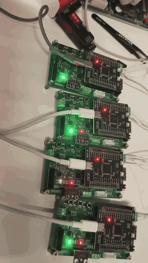

**节点正常运行：采集 → Flash 落盘 → TCP/CAN 上报**

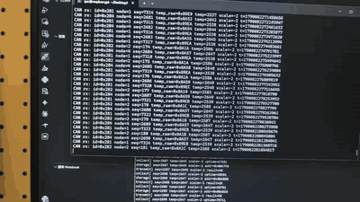

▶ [看原视频（清晰）](docs/develop/2026-09-22/video/平常运行演示.mp4)

**网关重启后节点自动重连，并补发积压的 pending**

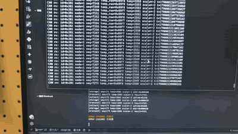

▶ [看原视频（清晰，含 3 倍速）](docs/develop/2026-09-22/video/重连一次性你发送pending.mp4)

> 终端录屏的 GIF 为了控制体积缩得较小、文字不易辨认；点上方原视频链接可清晰查看。

## 总体架构

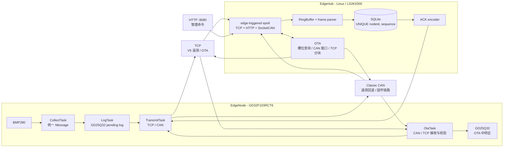

系统分为三条业务链：

1. **数据链**：传感器采样 → Message → Flash pending → TCP 或 CAN → Hub → SQLite。
2. **确认链**：SQLite 插入或去重命中 → ACK → 节点核对 `sequence` 与 CRC → Flash 状态改为 confirmed。
3. **固件链**：HTTP 指定目标与镜像路径 → Hub 经 CAN 窗口或 TCP 分块下发 → Node 确认接收并完成中转镜像校验 → 手动复位 → Bootloader 安装与试启动。

Flash 是数据链的本地恢复点，SQLite 是 Hub 侧的持久化事实源，ACK 是两者之间的确认桥梁。三者都不能被一次 socket 写成功替代。

## 关键设计取舍

| 实际问题 | 当前处理 | 代价与边界 |
| --- | --- | --- |
| `SEND OK` 只代表 ESP 接受发送，不代表 Hub 保存了数据 | 先写 Flash pending；Hub SQLite 成功或去重后才 ACK；Node 校验后写 confirmed | Flash 增加一次状态写入，交付速度受持久化与 ACK 影响 |
| Hub 已保存但 ACK 丢失 | 同一 `(nodeId, sequence)` 重发，数据库唯一索引去重，重复记录仍回 ACK | Node 必须恢复 sequence，不能因物理地址回环而复用业务身份 |
| TCP 与 CAN 切换可能重复上报 | 两条链路解码成同一个 Message，共用数据库身份；TCP 未确认才回退 CAN | 发送失败与确认丢失无法仅凭链路结果区分，因此允许重复传输 |
| 重连同步扫描挤占低优先级任务 | 每轮最多读 256 B；1918 B RAM 页位图建完后推进历史补发，同时继续新采样落盘与正常发送 | 首次历史补发需等完整建图；正常发送优先，吞吐不足时积压清理会延后；单页耗时仍需测量 |
| Flash 循环写入遇到未确认历史数据 | 进入 4 KiB 扇区前检查 pending，存在则拒绝擦除 | 长期离线到容量边界时可能暂停采集，当前不以覆盖 pending 换连续采集 |
| ISR 写 Flash 或大块复制会拖长中断 | ISR 做接收、组帧和通知，OtaTask 管理块处理与释放 | 必须明确队列传递的是数据还是缓冲引用，不能提前复用 |
| TCP 固件接收跟不上 Hub 连续发送 | 每块最多 768 B，Node 写入后确认，Hub 再发下一块；重复块只补回复 | 逐块等待 ACK 限制吞吐；断线后重新发起传输，不自动跨连接续传 |
| 接收镜像与运行新固件是不同事实 | 外置 Flash 中转校验后提示手动重启；Bootloader 再安装、试启动、确认 | HTTP 成功不证明安装或新业务恢复，版本显示以已确认 active_slot 为准 |
| 非阻塞 socket 一次发不完整帧 | 连接持有发送缓冲和偏移，等待可写事件续发，不把遥测 ACK 插入固件帧中间 | 慢连接仍需超时与资源管理，不能把入队当成送达 |
| HMI 页面早于状态恢复开始绘制 | 启动首帧和 Log 恢复之间用任务通知握手，页面只消费快照 | 屏幕数据是任务观测，不是对底层外设状态的自行推断 |

这些处理集中在数据身份、所有权和状态转换上：驱动负责一次器件访问，任务负责何时调度与谁持有缓冲，服务层决定何时接受、确认或重试。具体机制见下面各模块。

## EdgeNode：分层与任务协作

### 分层边界

| 层级 | 目录 / 示例 | 只负责什么 |
| --- | --- | --- |
| BOARD | [`edgenode/Drivers/BOARD/`](edgenode/Drivers/BOARD/) | 时基、共享 SPI 总线与板级通用策略。 |
| BSP | [`edgenode/Drivers/BSP/`](edgenode/Drivers/BSP/) | BMP280、GD25Q32、CAN、ESP-AT 串口、IPS 等具体器件访问。 |
| APP / Protocol | [`edgenode/User/App/`](edgenode/User/App/) | Message、TCP V5/CAN 编码、队列和业务状态；OTA 的协议判断位于 `Service/Ota`。 |
| FreeRTOS Tasks | [`edgenode/User/App/FreeRtos/Tasks/`](edgenode/User/App/FreeRtos/Tasks/) | Collect、Log、Transmit、Ota、Hmi、LED、StackMonitor 各有独立任务文件；任务负责调度和队列交接。 |
| Output | `Output/Log`、`Output/Tcp`、`Output/Can` | 把统一 Message 变为 Flash 日志、TCP 或 CAN 的实际输出。 |
| Bootloader / OTA | [`edgenode/bootloader/`](edgenode/bootloader/)、[`edgenode/Common/OTA/`](edgenode/Common/OTA/) | 校验镜像、管理内部 Flash 槽位和启动元数据；Bootloader 是独立工程。 |

这使“协议重试、Flash 确认”留在 APP，而不是污染设备驱动；也使 BMP280 与 GD25Q32 共用总线时，设备选择与底层时序仍属于 BOARD/BSP。

### 遥测主链上的三个任务

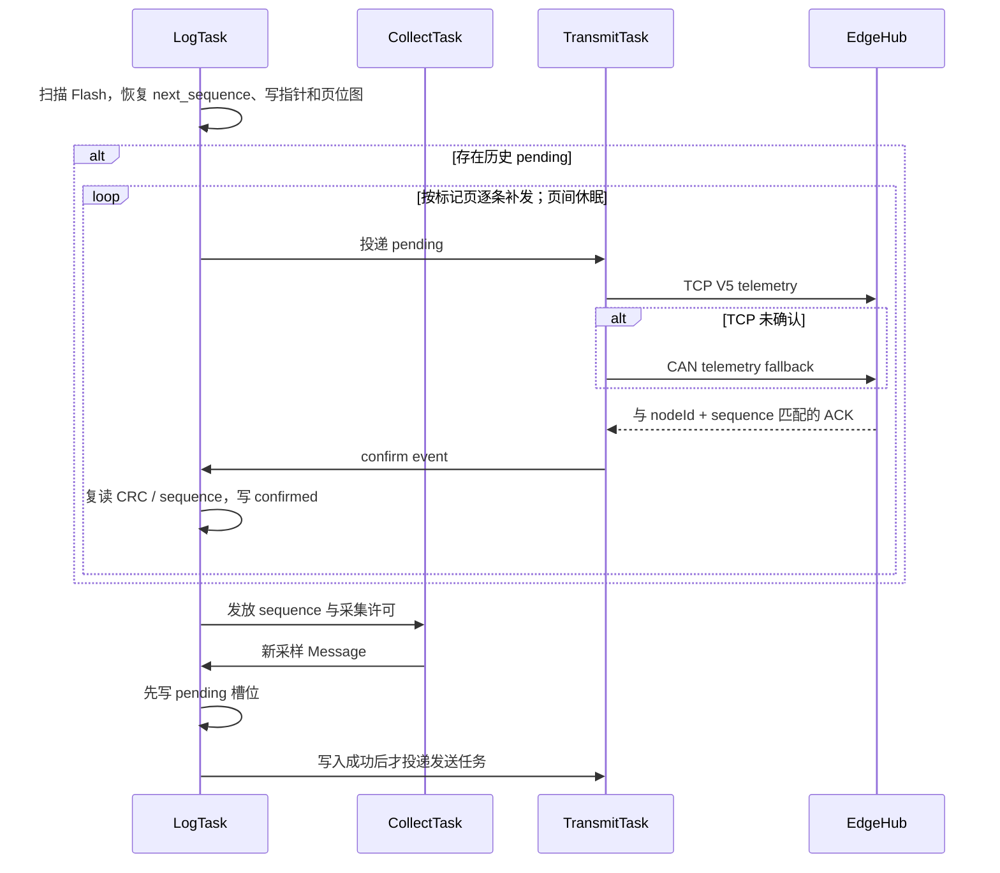

**LogTask 负责遥测日志的 Flash 写入与确认。** 它在启动时全量扫描日志区，恢复写指针、下一个 `sequence` 和 pending 页位图，随后放行 HMI 和可写时的采集，历史补发不再独占任务。运行期重连按开始时的最大已落盘 `sequence` 建图，完整扫描后才补发该范围内的历史记录；每轮同时处理新采样和正常发送。单条历史记录连续三次无法确认时，本轮补发停止，记录保留给后续重试；正常发送继续，采集仍受 Flash 可写条件与发送队列背压约束。

**CollectTask 不直接发送。** 它只有在 LogTask 发放许可后才采样，并将统一 Message 交回 LogTask。这样写 Flash 失败、缓存不可继续写入或补发期间，不会继续静默产生无处保存的新数据。

**TransmitTask 不直接确认 Flash。** 它先尝试 TCP V5，校验 ACK 的版本、目标节点、CRC、状态码和 `sequence`。TCP 未成功确认时回退 CAN，随后按冷却时间尝试恢复 TCP；两条链路都未确认时只报告失败，记录仍为 pending。TCP 重连和 CAN 发送目前共用这个任务，TCP 不通时 CAN 上报卡顿的问题由 [#7](https://github.com/xccloop/EdgeLink/issues/7) 跟踪。

其余任务各有自己的入口：`OtaTask` 接收 CAN 固件帧或 TCP 完整块并把回复交给 TransmitTask 发送；`HmiTask` 绘制屏幕；LED 任务负责指示；StackMonitor 任务检查任务栈。它们不改变上面“先落盘、后发送、ACK 后确认”的遥测顺序。

### 节点侧失败分支

| 场景 | 当前处理 | 数据结果 |
| --- | --- | --- |
| 新采样还未写入 Flash 时掉电 | 没有提交给 TransmitTask。 | 本次未持久化样本无法恢复；已提交样本不被误确认。 |
| 已写 pending、尚未得到 ACK | 重启后扫描为 pending 并参与补发。 | 允许重传。 |
| ACK 丢失或 ACK 的 `sequence` 不匹配 | 不产生确认事件。 | 记录保持 pending，Hub 可用唯一索引消化重传。 |
| 日志写入、读回或确认校验失败 | LogTask 停止继续访问队列/外设。 | 宁可停止采集，也不静默跳过 sequence 或覆盖未知数据。 |
| CAN 无物理 ACK | CAN 控制器发送邮箱可能占满，TransmitTask 不会把它当 Hub 成功确认。 | Flash pending 保留。 |

## EdgeNode：节点侧 HMI

HmiTask 独占 IPS 绘制，其他任务通过采样/事件队列和状态接口填入 `hmi_view_data_t`，页面只消费完整快照，不直接访问传感器、ESP 或 Flash。启动页首帧完成后才通知 LogTask 恢复，恢复前置流程结束后再放行正常页面，避免重启后残留上一轮画面。

HOME / LINKS / EVENTS / BACKLOG 分别展示采样、链路、收发事件和真实未确认数量。BACKLOG 只有成功写成 confirmed 后才下降；建图时发现 pending 不改变计数。版本读取元数据 `active_slot` 对应镜像头，试启动尚未确认时可能仍显示旧版本；新镜像完成中转校验后显示手动重启提示。页面、按键和逐行刷新细节见 [EdgeNode HMI](edgenode/README.md#节点侧-hmi)。

## EdgeNode：固件更新

Node 的 OTA 接收队列与遥测队列分开，CAN 与 TCP 共用 [`Service/Ota/ota.c`](edgenode/User/App/Service/Ota/ota.c) 的中转写入、镜像校验和安装入口：

- **CAN**：中断提交固件数据帧或槽位查询帧；OtaTask 按序接收 6 B 数据，累计 768 B 写入中转区。每连续接收 8 帧，或接收停顿时，回复连续接收序号。
- **TCP**：串口 ISR 按 `type`、帧头和有效长度组装完整块，支持跨 `+IPD` 的半包/粘包；完整块通过队列交给 OtaTask，数据缓冲处理完成前不得复用。每块最多 768 B，写入成功后才回复，重复的上一块只补成功回复，不重复写入或推进进度。
- **共同边界**：ISR 不写 Flash；协议与校验在服务层执行，队列和缓冲生命周期由任务层管理；回复统一由 TransmitTask 发送。尾块完成整包 Flash 读回 CRC 校验后才报告成功。

完整镜像校验通过后，Node 回复接收结果、保留已校验镜像，并在 IPS 提示重启，继续运行当前固件。用户复位或重新上电后，独立的 [`bootloader/`](edgenode/bootloader/) 再校验中转镜像、安装到非当前活动的内部 Flash 槽，并根据启动元数据决定试启动或回退。新 APP 运行约 10 秒后调用 `ota_confirm_boot()` 确认本次启动。Hub 下发的是带镜像头的应用固件，Bootloader 通过 SWD 首次部署。

内部 Flash 采用 16 KiB Bootloader、两个 118 KiB 应用槽和 4 KiB 元数据区；外部 GD25Q32 分开保存遥测日志和 OTA 中转镜像。分区地址、带头镜像及烧录注意事项见 [EdgeNode Flash 分区](edgenode/README.md#flash-分区与记录格式)，CAN/TCP 帧格式和下发步骤见 [EdgeHub README](edgehub/README.md#http-管理与固件下发)。

**验证情况：**[2026-10-12 开发记录](docs/develop/2026-10-12/main.md)记载 CAN A/B 双向升级、接收中途断电、Bootloader 搬运中途断电后恢复，以及损坏镜像拒绝。TCP OTA 与新版 pending 页索引补发的实现及主机验证见 [2026-10-13 开发记录](docs/develop/2026-10-13/main.md)，真机验收仍待完成。具体证据与限制见[验证记录与主机回归](#验证记录与主机回归)。镜像 CRC 用于发现损坏，当前未实现固件签名认证。

## Flash 日志：恢复逻辑与容量边界

每条 Flash 记录固定为 16 字节：

```text
byte 0..3    sample_uptime_ms       节点采样时刻
byte 4..7    sequence               端到端业务身份
byte 8..9    temperature            int16，大端补码
byte 10      temperature_scale      int8，温度 = raw × 10^scale
byte 11..14  CRC32                  覆盖 byte 0..10
byte 15      status                 0x00 = confirmed；其他值 = pending
```

日志区物理地址可以回绕，但 `sequence` 不能回绕：Hub 不应把一次新的采样误认成早期数据。由于回绕后“低地址是新记录、中间为空、高地址仍有旧记录”是可能的，启动扫描不能在第一个全 `0xFF` 槽位停止，而是遍历整个日志区：

- CRC 正确的最大 `sequence` 用来恢复下一写地址和下一个序号；
- CRC 正确且未 confirmed 的记录计入 pending，并标记所在页；补发按物理页顺序进行，不承诺回环后仍按 `sequence` 排序；
- 非空但 CRC 错的槽位可能是掉电半写，不能当作有效数据，也不能再次编程。

当前实现在进入新 4 KiB 扇区前，会检查目标扇区是否仍含有效 pending；若存在则拒绝擦除。因此“长期离线时覆盖最旧 pending 以保持持续采集”目前只是待定容量策略，不应被包装成已经完成的功能。实现入口见 [`log.c`](edgenode/User/App/Output/Log/log.c)。

### 重连后的页索引与集中补发

日志区共有 **15344 页**，每页 256 B、16 条记录。用每页 1 bit 的 **1918 B RAM 位图**保存哪些页含有效 pending，另用独立 256 B 缓冲读取补发页：

1. **固定历史边界**：保存开始时最大已落盘的 `sequence`；之后的新记录继续落盘、正常发送，不延长本轮历史范围。
2. **完整建图**：每轮最多读取一页并让出 CPU，扫描期间继续处理新采样与确认；扫描完成后才进入历史补发，pending 为零可直接结束。
3. **穿插补发**：从位图定位目标页，校验 CRC、状态及历史序号范围；仅保存一条历史工作，投递后返回主循环，不在 LogTask 内等待 ACK。普通工作优先，已有普通发送结果全部处理后才投递历史。
4. **失败与背压**：单条历史记录连续失败三次结束本轮，正常采集继续；新记录发送失败后，在后续普通发送成功或重连时安排新一轮恢复。发送队列满时保留待投递记录并暂缓下一采集许可；目标扇区仍含 pending 时不擦除，确认释放空间后自动重新检查许可。

位图只保存位置，发送内容仍需从 GD25Q32 读取。RAM 索引断电丢失后可从 Flash 中的真实记录重建，不承担数据持久化职责。同页追加和整扇区擦除会使受影响的补发缓存失效，旧确认通过地址和 sequence 核对，不能确认已复用槽位的新记录。首次历史补发要等待完整建图，积压清理总时间仍取决于扫描和 ACK 速度；正常流量持续占满吞吐时，历史补发可能长期等待。原有上电初始化扫描仍为同步全区遍历，主机模拟不等于 IPS、SPI 和持续采样已完成真机验收。

## EdgeHub：事件循环、解析与幂等持久化

EdgeHub 的入口在 [`edgehub/main.cpp`](edgehub/main.cpp)，运行时资源由 [`Gateruntime`](edgehub/src/Gateruntime.cpp) 管理。`Gateruntime::init()` 在 SocketCAN、TCP 监听、`epoll` 或 SQLite 任一步失败时返回 `false`，`main.cpp` 会**就此退出**，不会带着没建好的 `epoll` 进入事件循环——否则会报出一句误导人的 `epoll error: Invalid argument`，把真正的失败原因（比如端口已被占用）盖住。

```text
TCP :8888          HTTP :8080          SocketCAN can0
    │                   │                    │
    └───────────────────┼────────────────────┘
                        ▼
             edge-triggered epoll
        ┌───────────────┼────────────────┐
        ▼               ▼                ▼
      遥测帧         HTTP 请求       CAN / TCP OTA 回复
        │               │                │
TCP RingBuffer /     路由解析        查询匹配 / 窗口确认
CAN payload decoder     └────────┬───────┘
        │                        ▼
  unified Message           OTA 业务结果
        │                        │
 SQLite 插入 / 去重         HTTP 响应
        │
成功或已存在才回复 ACK
```

上图的持久化路径用于遥测。HTTP 客户端由独立的请求解析状态处理，OTA 回复交给对应查询/发送状态，再关联等待中的 HTTP 请求；CAN 窗口、TCP 分块发送和超时检查由事件循环推进。同一 TCP 连接上的遥测 ACK、查询回复和固件发送使用连接输出缓冲，避免将 ACK 字节插入尚未发完的固件帧。

### 为什么使用 `epoll + RingBuffer`

TCP 没有消息边界：一次 `recv` 可能只得到半帧，也可能得到多帧。Hub 为每个客户端维护独立 RingBuffer，解析结果明确区分三种状态：

- **pending**：字节不足一帧，保留数据等待下一次可读事件；
- **success**：完成 V5、节点号和 CRC 校验后，转换为 Message；
- **error**：错误帧导致关闭该客户端，避免损坏字节流不断进入业务层。

边沿触发模式下，收到事件后必须持续 `accept` / `recv` / CAN `read` 直到 `EAGAIN`，否则剩余数据不会再次触发通知。Hub 因而使用单一事件循环同时处理 TCP 监听、多个客户端和 `can0`，而不是为每条连接新建阻塞线程。

### 为什么 ACK 在 SQLite 之后

SQLite 表对 `(nodeId, sequence)` 建立唯一索引，写入使用：

```sql
INSERT INTO messages (nodeId, sequence, temperature, temperatureScale, receivedAtUs)
VALUES (?, ?, ?, ?, ?)
ON CONFLICT(nodeId, sequence) DO NOTHING;
```

| SQLite 结果 | Hub 行为 | 节点下一步 |
| --- | --- | --- |
| `Inserted` | 回成功 ACK。 | 核对后确认对应 Flash 槽位。 |
| `Duplicate` | 同样回成功 ACK。 | 结束旧 pending 的重传。 |
| `Error` | 记录错误，不回成功 ACK。 | 保持 pending，后续重试。 |

这就是幂等的关键：ACK 表示“Hub 已经拥有这个业务身份的记录”，不是“当前这次 socket 收包看起来没有报错”。`receivedAtUs` 为 Hub 完成整帧校验时的接收时间，不是节点 `sample_uptime_ms`。

## 验证记录与主机回归

下表区分开发记录中的实测、代码/主机验证与尚未完成的设备验收，不把 HTTP 下发成功当成新固件已经运行。

| 项目 | 已有证据 | 待验证边界 |
| --- | --- | --- |
| 多节点遥测、断线恢复与历史补发 | [2026-09-22 演示](docs/develop/2026-09-22/) | 历史演示不等于新版页索引已在硬件上通过 |
| CAN OTA 与 A/B 安装 | [2026-10-12 记录](docs/develop/2026-10-12/main.md)：版本/槽位切换、接收中途断电、搬运中途断电后恢复、损坏镜像拒绝 | 是已记录场景的结果，尚不能覆盖所有断电时刻、回退分支和长期稳定性 |
| TCP OTA | 两端已实现；[2026-10-13 记录](docs/develop/2026-10-13/main.md)保存编译及静态审查结果 | 真机下发、重复块应答、尾块校验、断线后重新下发待验收 |
| 重连页索引补发 | `test_log_replay.py` 模拟 GD25/队列运行真实 Log 与 LogTask 代码；plain/A/B 有编译通过记录 | 真机扫描耗时、IPS 持续刷新、SPI 争用和大量积压清理待测 |
| 固件手动重启 | `test_ota_manual_restart.py` 模拟中转 Flash、运行真实 OTA 与 HMI Page 代码，检查完成状态及重启提示 | 主机检查不能替代实际复位、安装及新版本业务恢复 |

主机回归命令、依赖与旧 ESP 测试桩缺失的问题见 [EdgeNode 验证说明](edgenode/README.md#主机回归与设备验证)。主机测试模拟 Flash、队列或 UART/时间，不能替代真实 FreeRTOS 抢占、SPI 时序和端到端升级验收。

## 资料索引

- [EdgeNode 架构图（draw.io）](docs/draw/edgenode.drawio)
- [EdgeHub 架构图（draw.io）](docs/draw/edgehub.drawio)
- [开发日志索引](docs/develop/README.md)
- [TCP V5 与 ACK 编码实现](edgehub/inc/TcpFrame.hpp)
- [Hub HTTP 路由](edgehub/src/HttpHandle.cpp)
- [Hub CAN / TCP 固件发送与回复处理](edgehub/src/OTA.cpp)
- [Node 内部 Flash 分区](edgenode/Common/OTA/flash_layout.h)
- [EdgeNode 构建与验证](edgenode/README.md)
- [EdgeHub 构建、操作与协议](edgehub/README.md)
- [APP 分层与任务入口](edgenode/User/App/README.md)
- [CAN OTA 实测记录（2026-10-12）](docs/develop/2026-10-12/main.md)
- [TCP OTA 与页索引补发（2026-10-13）](docs/develop/2026-10-13/main.md)
- [已知问题与后续工作](https://github.com/xccloop/EdgeLink/issues)
- [2026-09-15 调试记录](docs/develop/2026-09-15/main.md)

## 项目边界

当前阶段已实现 Node 遥测、Flash 日志恢复、Hub 持久化与 ACK，以及 CAN/TCP 应用固件下发。项目保留的遥测实机记录涵盖多节点运行、断线重连与 pending 补发，并记载过 72 小时无死机运行；CAN OTA 已有部分升级和故障恢复实测。新版页索引补发与 TCP OTA 尚待真机验收，已有结果按上表逐项列出。

后续工作集中在现有 issue：

- [#1](https://github.com/xccloop/EdgeLink/issues/1)、[#7](https://github.com/xccloop/EdgeLink/issues/7)：新版 pending 页索引的硬件验收、TCP 未连通时 CAN 上报卡顿。
- [#3](https://github.com/xccloop/EdgeLink/issues/3)、[#4](https://github.com/xccloop/EdgeLink/issues/4)：在已有 CAN 升级与掉电测试基础上补充故障覆盖，并验证 TCP OTA。
- [#5](https://github.com/xccloop/EdgeLink/issues/5)、[#6](https://github.com/xccloop/EdgeLink/issues/6)：看门狗与任务健康监督、Hub 持久化故障验证。
- [#2](https://github.com/xccloop/EdgeLink/issues/2)：Hub 与 Dash 的节点状态和波形接口。`edgedash/` 当前为独立 EasyUI 仪表板原型。

CAN 进度/结果帧没有传输编号，无法彻底区分同节点旧传输的迟到回复；接收中的重复/乱序 CAN 帧不推进序号，不能假设每次都会重新应答；完成后的尾帧重传已支持补发成功结果。Hub 对无法确认的传输返回超时。TCP 数据传输已带 `transfer_id` 并支持上一块重复应答，但槽位查询仍是无请求编号的两字节协议，查询超时后 Hub 关闭连接以隔离迟到回复。HTTP 管理接口尚未实现身份认证，固件也未签名，应在受控局域网内使用。

## 硬件原理图与 PCB

`docs/PCB/` 保存 EdgeNode 的硬件设计预览，分为核心控制板（`CORE`）和扩展采集板（`EXP`）。下面的图片用于让读者快速核对软件所依赖的电源、MCU、调试和外设接口边界；它们是原理图/布局导出，不代替已焊接板的上电、信号完整性或外设实测结论。

### 核心控制板（CORE）

核心板以 GD32F103RCT6 为控制中心，提供 Type-C 供电与 CH340 串口、SWD 下载接口、8 MHz 与 32.768 kHz 时钟、复位/唤醒按键、3.3 V 降压电源及向扩展板引出的排针接口。

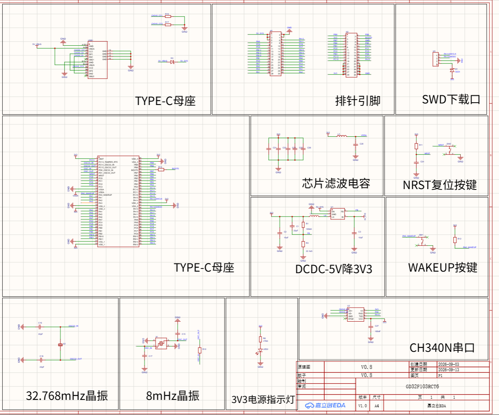

### 扩展采集板（EXP）

扩展板将网络、现场总线、采集、显示和供电模块集中到核心板接口：

- ESP-12S Wi-Fi 与 2.4 GHz 天线区域，对应节点的 ESP-AT TCP 通路；
- SN65HVD230 CAN 收发器，对应 TCP 未确认时的 CAN 回退设计；
- SPI Flash 与 BMP280 接口，对应本地 pending 日志与温度采样；
- IPS 显示接口、RS485、12 V 电压采样、按键、PWM 和 12 V → 5 V 电源链路。

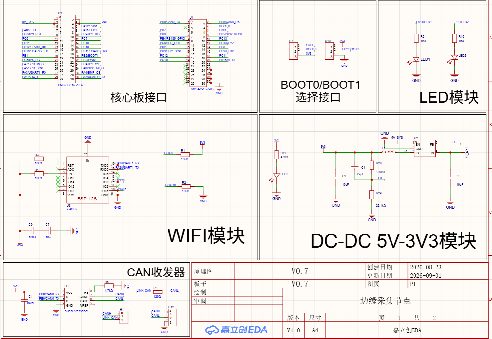

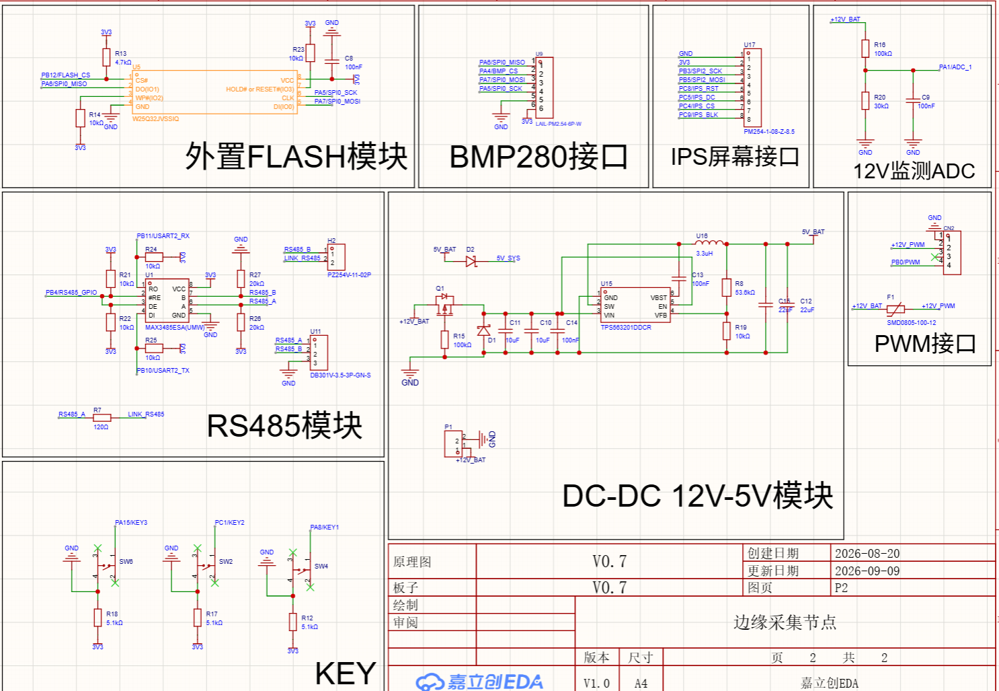

### PCB 布局预览

原理图说明电气连接，PCB 截图说明模块在两块板上的实际布局和走线分区。`PCB_ON` 为顶层预览，`PCB_OFF` 为底层预览；完整导出文件位于 [`docs/PCB/CORE/`](docs/PCB/CORE/) 与 [`docs/PCB/EXP/`](docs/PCB/EXP/)。

#### 核心控制板 PCB

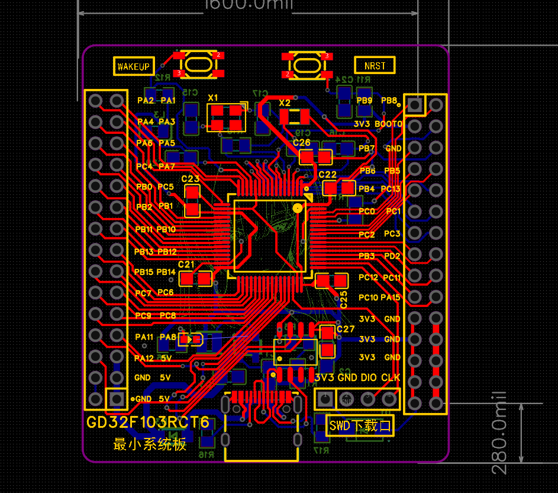

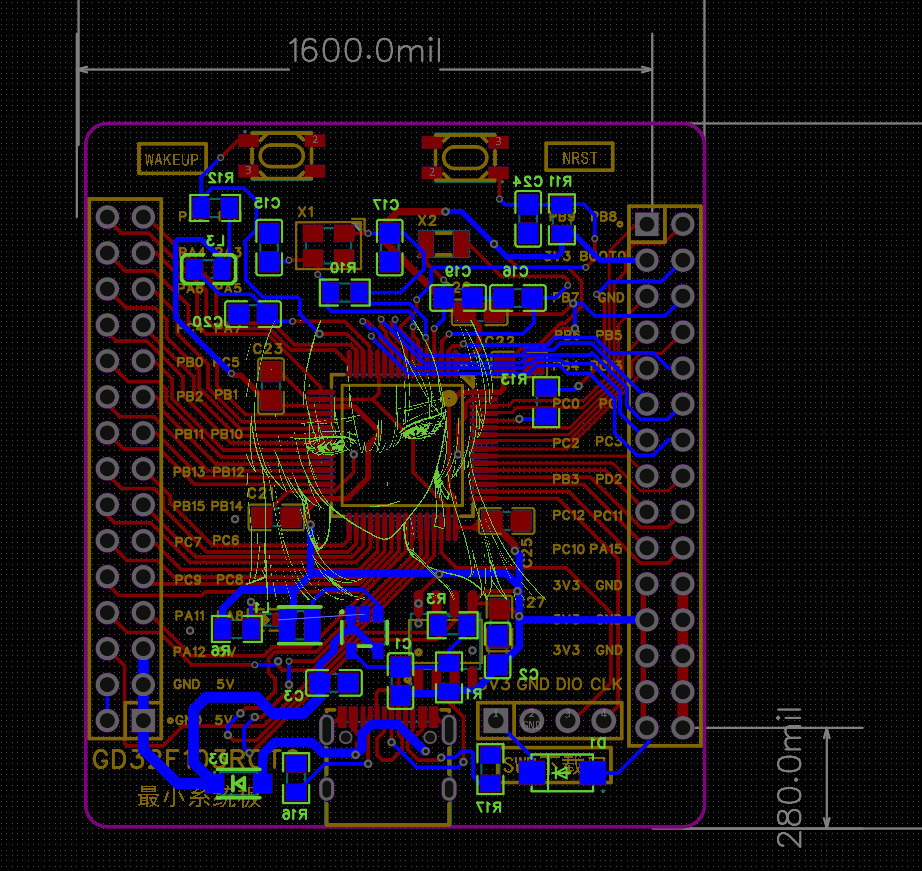

#### 扩展采集板 PCB

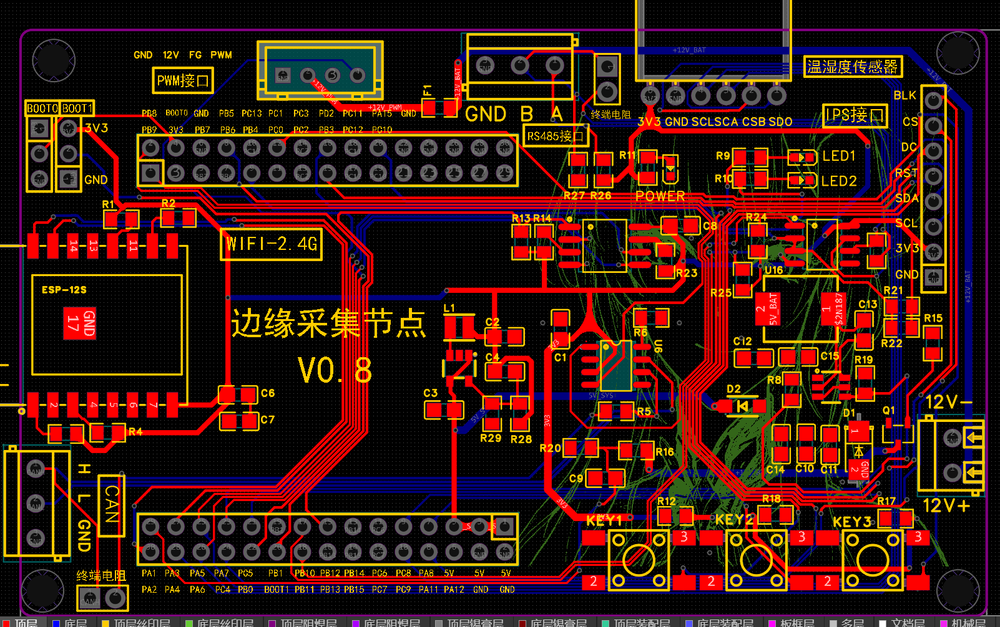

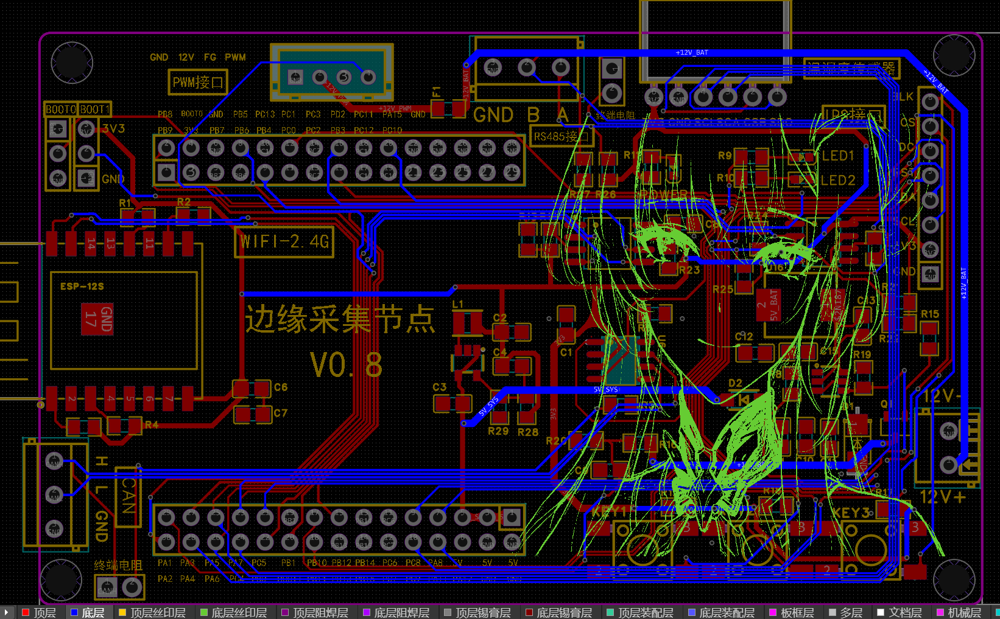
